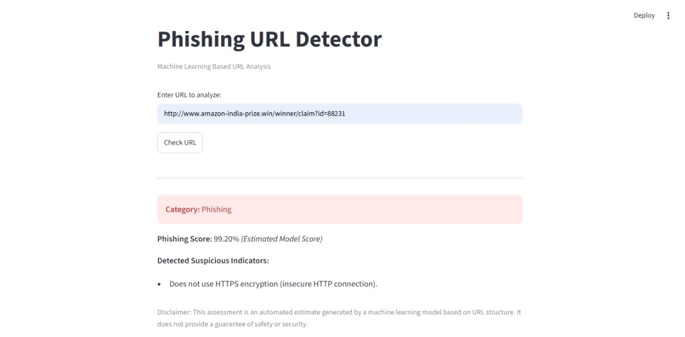
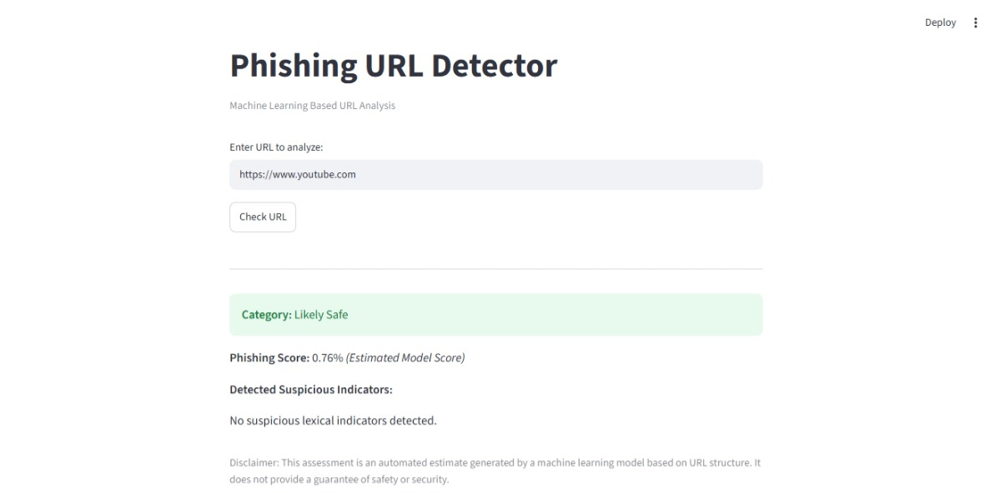

# Phishing URL Detector 🛡️

A machine learning-based web application that analyzes URLs and estimates their phishing risk using lexical and structural URL features. Built with Python, Scikit-learn, and Streamlit.

## Project Overview

Phishing websites often imitate legitimate websites to trick users into sharing passwords, banking details, and other sensitive information. This project aims to identify suspicious URLs before users visit them.

The application analyzes the structure and text of a URL without opening the website or downloading its content.

**Important:** This is an educational machine learning project. Its predictions are estimates and should not be treated as a guarantee of website safety.

## Features

- URL validation to reject empty or invalid inputs.
- URL normalization for consistent feature extraction.
- Extraction of 13 numerical URL features.
- Random Forest classification.
- Three risk categories: Likely Safe, Suspicious, and Phishing.
- Phishing risk score displayed as a percentage.
- Human-readable explanations of suspicious URL patterns.
- An informational domain advisory for selected known domains. This advisory does not override the model's prediction.
- Streamlit-based user interface.

## Technologies Used

- Python
- Pandas and NumPy
- Scikit-learn
- Streamlit
- Joblib
- Matplotlib

## How It Works

1. The user enters a URL.
2. The application validates the input.
3. The URL is normalized.
4. The feature extraction module calculates 13 numerical features.
5. The trained Random Forest model estimates the phishing score.
6. The application displays the risk category, score, and detected indicators.

## Extracted URL Features

The model uses these 13 features:

1. URL length
2. Domain length
3. Number of dots
4. Number of hyphens
5. Presence of the `@` symbol
6. Number of digits
7. Digit ratio
8. HTTPS usage
9. IP address usage
10. Number of subdomains
11. Number of suspicious keywords
12. Double slash in the URL path
13. URL path depth

These features describe URL structure and text. The application does not inspect webpage HTML, page content, or JavaScript.

## Machine Learning Model

The shipped model is a **Random Forest Classifier** with 100 estimators and 13 input features.

The model bundle identifies it as the Path-Balanced Experimental model.

The experimental training pipeline uses URL datasets and an additional collection of legitimate deep-path URLs. The training script saves its output as `phishing_model_experimental.pkl`. The model included with this project is supplied separately as `phishing_model.pkl`.

The original baseline training script, `model_training.py`, is retained for reference. It should not be used to replace the supplied model.

**Training-data note:** The original PhiUSIIL and LegitPhish CSV datasets are not included in this repository. Therefore, reproducing the complete training process requires obtaining those datasets separately and satisfying the training script's dependencies.

## Risk Categories

| Model score | Result |
|---|---|
| Below 35% | Likely Safe |
| 35% to below 70% | Suspicious |
| 70% or above | Phishing |

A Likely Safe result does not guarantee that a website is safe.

## Evaluation Results

The project includes evaluation metrics in `metrics.json` and diagnostic test output in `master_test_results.txt`.

### 1. Held-out benchmark evaluation

The recorded evaluation uses 12,000 held-out samples from the balanced experimental dataset.

| Metric | Recorded result |
|---|---:|
| Accuracy | 99.15% |
| Precision | 99.35% |
| Recall | 98.95% |
| Specificity | 99.35% |
| Balanced Accuracy | 99.15% |
| F1-Score | 99.15% |
| ROC-AUC | 0.9974 |

**Confusion Matrix**

| | Predicted Legitimate | Predicted Phishing |
|---|---:|---:|
| Actual Legitimate | 5,961 | 39 |
| Actual Phishing | 63 | 5,937 |

These are the recorded results for the project's held-out benchmark split. They should not be interpreted as guaranteed performance on new websites or unseen domains.

### 2. OpenPhish diagnostic evaluation

The included diagnostic log records predictions for 300 URLs from an OpenPhish snapshot.

| Detection threshold | URLs detected | Detection rate |
|---|---:|---:|
| 70% or above | 259 / 300 | 86.33% |
| 50% or above | 263 / 300 | 87.67% |
| 35% or above | 267 / 300 | 89.00% |

This is a diagnostic evaluation on the supplied snapshot, not a guarantee of future phishing detection performance.

### 3. Legitimate URL diagnostic checks

The recorded metrics also report:

- Legitimate homepages classified as safe: 30 / 30.
- Legitimate deep-path URLs classified as safe: 13 / 15.

## Known Limitations

The model has limitations that are important when interpreting its predictions:

1. **URL-only analysis:** It does not inspect website content, HTML, JavaScript, or page behaviour.
2. **No domain reputation lookup:** It does not check domain registration age, WHOIS information, or live reputation services.
3. **Bare-domain false positives:** Some legitimate domains, including `github.com`, may receive high phishing scores. The diagnostic log records this behaviour.
4. **Sensitive words in legitimate paths:** Legitimate banking and account-related URLs may be classified as suspicious or phishing because they contain words such as `banking`, `pay`, or `cards`.
5. **Domain overlap:** The benchmark uses a random stratified split, not a fully domain-disjoint evaluation. Its scores should not be interpreted as proof of generalization to entirely unseen domains.
6. **Imperfect detection:** Some phishing URLs may not be detected, and some legitimate URLs may be flagged.

The application includes an informational domain advisory for selected domains. It explains certain known false positives but does not change the model's score or prediction.

## Project Structure

```text
phishing-url-detector/
│
├── app.py
├── feature_extraction.py
├── phishing_model.pkl
├── train_experimental_model.py
├── model_training.py
├── metrics.json
├── requirements.txt
├── README.md
├── .gitignore
│
├── run_fix4_tests.py
├── run_master_tests.py
├── master_test_results.txt
├── run_comprehensive_validation.py
├── normalization_and_validation_results.txt
│
├── feature_importance.png
├── ss1.jpeg
└── ss2.jpeg
```

The original training datasets and live threat-feed snapshot are not included in the public repository.

## Installation and Execution

### 1. Clone the repository

```bash
git clone https://github.com/YOUR-USERNAME/phishing-url-detector.git
cd phishing-url-detector
```

### 2. Install dependencies

```bash
pip install -r requirements.txt
```

### 3. Run the application

```bash
python -m streamlit run app.py
```

The application will open in your browser, usually at:

```text
http://localhost:8501
```

The supplied `phishing_model.pkl` file must be present in the project directory.

## Screenshots

### Likely Safe URL



### Phishing URL



## Future Improvements

- Add domain reputation and domain-age checks.
- Improve classification of legitimate bare domains.
- Improve detection of legitimate banking and account-related URLs.
- Evaluate on a domain-disjoint dataset.
- Expand testing with more recent phishing and legitimate URLs.

## Disclaimer

This project is developed for educational and demonstration purposes. The model analyzes URL text and structure only. A Likely Safe result does not guarantee that a website is trustworthy. Always verify a website's authenticity before entering sensitive information.

## Author

Developed as a Machine Learning project using Python, Scikit-learn, and Streamlit.
